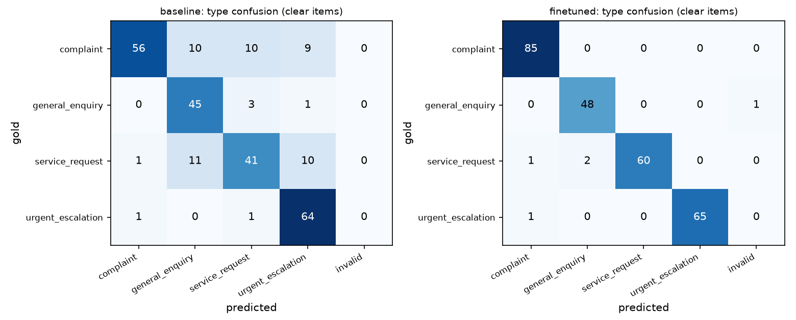
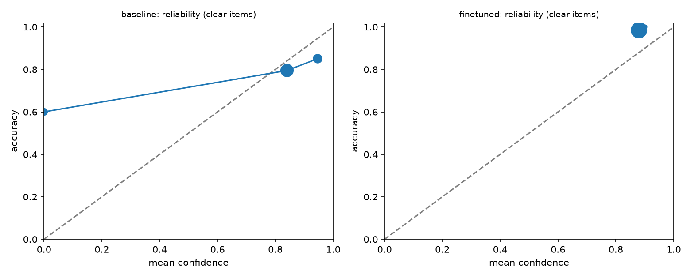
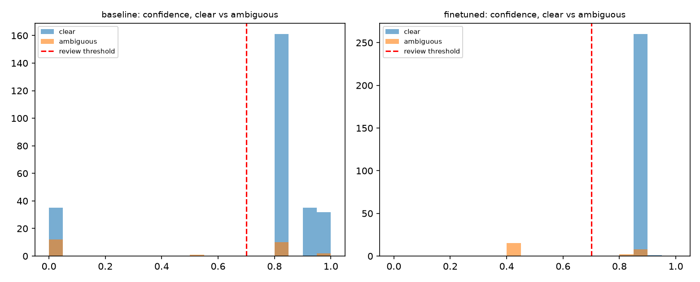
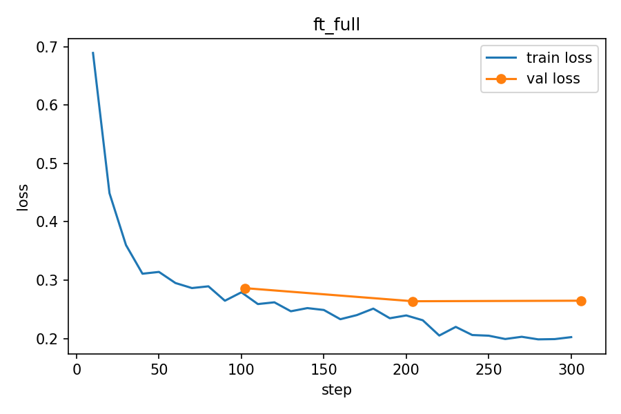

# Fine-Tuned Request Classifier

A LoRA/QLoRA fine-tune of **Llama 3.2 3B Instruct** that replaces a ~1,000-token prompt-engineered classifier in an n8n + Ollama customer-request triage workflow. The model classifies; deterministic workflow logic still makes every routing decision, and low-confidence or invalid outputs go to a human.

**Built with Llama.**

**Links:** [Model on Hugging Face](https://huggingface.co/Sanved13/Llama-3.2-3B-request-classifier) | [Run the live demo in Colab](https://colab.research.google.com/github/Sanved-Jagatap/llama-request-classifier/blob/main/demo/colab_demo.ipynb)

**Result in one line:** on a held-out test set, request-type accuracy rose from **78.3% to 98.1%** (AI-assisted, author-reviewed subset: 83.6% to 97.3%), false emergency alarms fell from **10.2% to 0%**, hallucinated entities fell from **13.2% to 3.1%**, the prompt shrank from **998 to 128 tokens**, and latency dropped **43%**, all running locally through Ollama.

## Results (288-item test set, same parser, temperature 0, same machine)

| Metric | Baseline (production prompt, llama3.2) | Fine-tuned (Q4_K_M via Ollama) |
|---|---|---|
| Type accuracy (clear items) | 78.3% | **98.1%** |
| Type macro-F1 | 77.9% | **98.2%** |
| **AI-assisted, author-reviewed subset:** type accuracy (73 items) | 83.6% | **97.3%** |
| Emergency recall | 97.0% (64 of 66) | 98.5% (65 of 66) |
| **AI-assisted, author-reviewed subset:** emergency recall (19 items) | 89.5% (17) | 94.7% (18) |
| False-emergency rate (lower is better) | 10.2% | **0.0%** |
| Urgency accuracy (see caveat) | 51.7% | 69.6% |
| Entity match: invoice / amount / currency | 89.3% / 79.5% / 89.3% | **95.3% / 99.1% / 97.2%** |
| Hallucinated entities (lower is better) | 13.2% | **3.1%** |
| Full-schema compliance | 71.9% | **99.7%** |
| Clear messages sent to human review needlessly | 13.3% | **0.4%** |
| Overall human-review rate | 16.7% | **5.6%** |
| Ambiguity detection: precision / recall | 27.1% / 52.0% | **93.8% / 60.0%** |
| **AI-assisted, author-reviewed subset:** ambiguity recall (13 items) | 76.9% | **92.3%** |
| Calibration error (ECE, lower is better) | 0.132 | 0.105 |
| Prompt tokens (mean) | 998 | **128** |
| Latency mean / p95 (s) | 2.64 / 3.07 | **1.51 / 1.75** |

## Results & Visualizations

### Confusion Matrix

### Reliability Diagram

### Confidence Distribution

### Training Loss

### How to read these numbers honestly
- **Lead with the AI-assisted, author-reviewed subset.** The 86 AI-assisted, author-reviewed messages were drafted with AI assistance (Claude) and reviewed by me. They were never produced by the data generator (`mistral:7b`) or seen in training, so they are the fairest check available, but they share my labelling conventions and are not real customer traffic. On type accuracy the gain is 61 of 73 correct to 71 of 73, which is unlikely to be noise. Counts are small, so single-digit differences elsewhere in that subset should not be over-read.
- **The synthetic test items are easier than real traffic.** They come from the same generator and filtering as the training data, so synthetic scores are optimistic.
- **Urgency is the weakest metric and the noisiest.** Urgency levels such as medium vs. high were assigned by the data design and are partly arbitrary even for a person. Critical is learned well; low/medium are not reliably separable.
- **Confidence means clarity, not correctness.** Training targets came from a clarity tier (clear 0.85 to 0.98, vague 0.30 to 0.60). ECE only improved modestly (0.132 to 0.105), and the model is still somewhat overconfident on wrong answers.
- **Overall ambiguity recall (60%) understates the model.** Several synthetic "ambiguous" rows were actually specific (for example "charged 350 USD on inv-24570, expected 200"), so being confident on them is arguably correct. On the 13 AI-assisted, author-reviewed vague messages, 12 were routed to review.
- **Exporting to 4-bit GGUF and serving through Ollama had a small cost.** Evaluated in Colab before export (Hugging Face inference), the same adapter scored 98.5% type accuracy and 100% AI-assisted, author-reviewed ambiguity recall; after Q4_K_M in Ollama it is 98.1% and 92.3%, with hallucinated entities rising from 0.7% to 3.1%. The gap combines quantization with a different inference stack, so I can't attribute it to quantization alone.

### Known failure modes
- **Non-security emergencies.** The model learned that "urgent" means account compromise or access loss. It can miss a business emergency such as a checkout integration failing during a sale, or a legal threat. Adding outage and legal-threat examples is the first thing to fix.
- **One output (0.3%) was not parseable**; the workflow's validation sends such cases to human review.

## Live end-to-end check (n8n)
I also ran 10 hand-picked requests through the real n8n workflow (form/console, fine-tuned model, deterministic routing, Google Sheets audit log). All 10 were routed as expected:

| Request | Result |
|---|---|
| Wrong invoice amount | Complaint, escalated to Senior Support |
| Weekend support hours | Enquiry, resolved |
| Change registered phone number | Service Request, Account Services |
| Account taken over, locked out | Urgent, human review required |
| "I need help with something." | Human Review (confidence 0.43) |
| "URGENT!!!" request for an invoice copy | Service Request, Billing (not fooled by the wording) |
| Calm note about logins from two countries | Urgent, human review required |
| Angry repeated double charge | Complaint, escalated (not Urgent) |
| SSO question under time pressure | Enquiry, resolved |
| Checkout errors during a sale | Urgent, human review required |

These cases were chosen to include known hard patterns, so treat this as a sanity check, not a benchmark. The checkout case passed once here, but similar non-security emergencies were missed in the offline test.

## Method

| Stage | What happened |
|---|---|
| Task | Same JSON schema as the production workflow: type, urgency, sub-topic, confidence, summary, sentiment, entities, required action |
| Data generation | 3,123 raw rows from `mistral:7b` (local Ollama, ~800 calls). Type, urgency and clarity are **chosen per scenario**, so the main labels are correct by construction; confidence comes from the clarity tier, not the generator |
| Cleaning | Rule-based validation (no invented entities, urgency/type consistency, no markdown artifacts, ambiguous messages must be short), automatic repair of formatting slips, near-duplicate and invoice-number repetition limits |
| Label check | A second model (`llama3:8b`) classified each message blind; rows where it disagreed were dropped (29% of clear rows). Hard cases (calm-sounding emergencies, urgent-sounding routine requests) were not removed disproportionately |
| Final data | 1,617 train / 202 validation / 288 test (202 synthetic + 86 AI-assisted, author-reviewed, test-only) |
| Manual review | 80 random training rows reviewed: 6.2% label errors (review done with AI assistance) |
| Training | QLoRA (4-bit), Unsloth + TRL, LoRA rank 16, alpha 16, 3 epochs, LR 2e-4, loss on the answer tokens only, free Colab T4 GPU |
| Export | Merged and quantized to GGUF Q4_K_M (~2 GB), registered in Ollama |
| Integration | Two n8n nodes changed (prompt builder and model name); parsing, the 0.70 confidence gate, branches and audit log unchanged (`docs/N8N_SWAP.md`) |

Training note: validation loss rose after epoch 1 while training loss kept falling. Validation loss counts every token, including free-text fields like the summary, so it overstates the problem for the classification fields, but it suggests 1 to 2 epochs may be enough (not tested).

## Limitations
- Mostly synthetic, English-only data; real customer language will differ.
- Small AI-assisted, author-reviewed test set (86); wide uncertainty on subset metrics.
- Label judge and generator are small local models and can share blind spots.
- Entity labels miss lowercase invoice IDs and treat agent/ticket IDs as invoices in a few rows (about 5 to 8% of rows).
- Not tested for fairness across dialects or languages.

## Reproduce
Full command sequence with where each step runs: `CHECKLIST.md`. Task spec and metric definitions: `SPEC.md`.

| Step | File |
|---|---|
| Data generation / validation / split | `generate_dataset.py`, `build_dataset.py`, `common.py` |
| Label check and diagnostics | `verify_labels.py`, `diagnose.py`, `review_sample.py` |
| Baseline and model inference via Ollama | `run_model.py` (baseline prompt in `prompts/baseline_prompt.txt`) |
| Metrics and charts | `evaluate.py`, `report.py` |
| Training | `training/train_lora.ipynb` (and `training/export_gguf.ipynb` for export only) |
| Ollama model | `Modelfile` |
| Live demo (Colab) | `demo/colab_demo.ipynb` |

## License and attribution
- Model: fine-tune of Llama 3.2 3B Instruct, distributed under the Llama 3.2 Community License. Built with Llama.
- Training data: synthetic, generated with `mistral:7b` and filtered with `llama3:8b`; the 86 test messages were drafted with AI assistance and reviewed by the author.
- Code: MIT License (see [LICENSE](LICENSE)).
